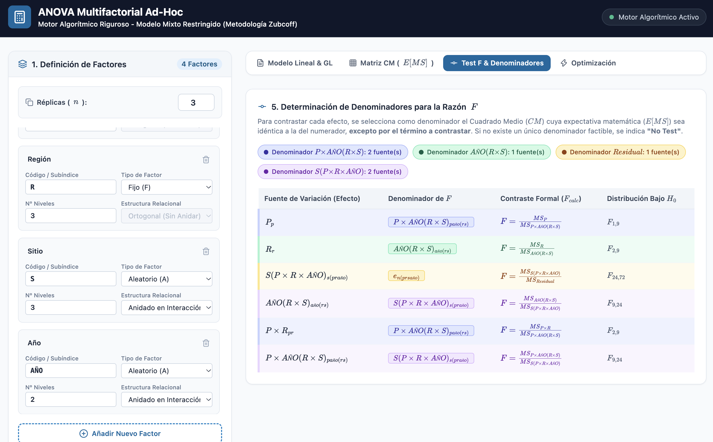
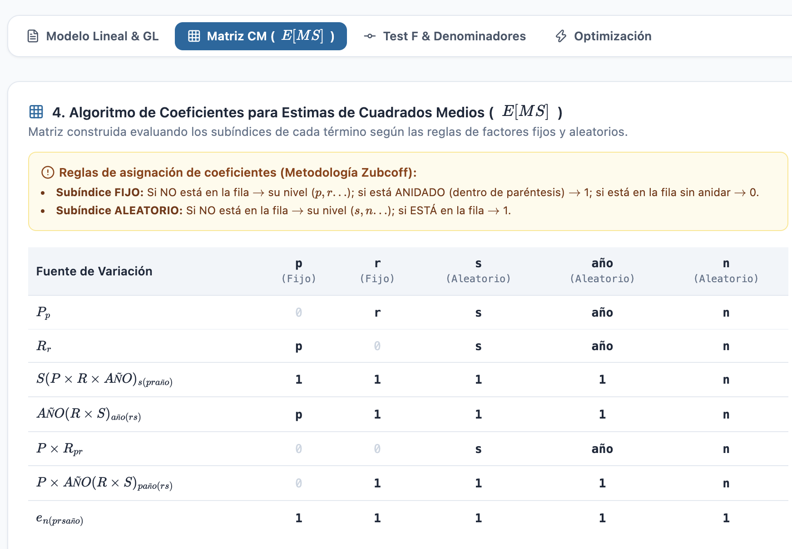
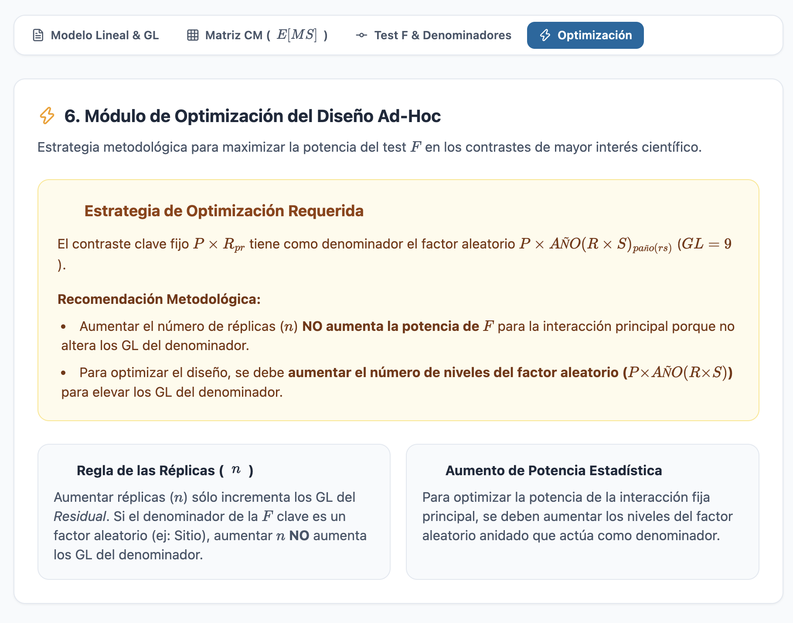

# Ad-Hoc Multifactorial ANOVA - J. Zubcoff Methodology

A rigorous algorithmic engine for designing multifactorial ANOVA models based on Restricted Mixed Models. This tool automates the generation of linear models, Degrees of Freedom (DF), Expected Mean Squares (E[MS]) matrices, and exact $F$-test denominators. Also optimises the final model.

## 🚀 Features

* **Dynamic Ad-Hoc Modeling:** Flexible configuration of fixed and random factors, orthogonal or nested structures, and customizable replicate counts.
* **Clean Mathematical Syntax:** Formal generation of linear models, rendering complex equations perfectly via MathJax.
* **E[MS] Matrix Algorithm:** Automated structuring of expected mean squares applying restricted mixed model coefficient rules.
* **Denominator Evaluation:** Strict comparison of variance components in $E[MS]$ to find exact denominators (or output "No Test" when none exist).
* **Optimization Module:** Methodological strategies to maximize the statistical power of the main F-test for scientific interests.

## 🛠️ Usage

This project is entirely client-side. No backend or build steps are required.

1. Clone this repository or download the `index.html` file.
2. Open `index.html` in any modern web browser.
3. Start defining your factors, levels, and nesting relationships in the left panel.

## 📚 Methodology

This application is strictly based on the methodological guidelines provided by Prof. Jose Jacobo Zubcoff (Department of Marine Sciences and Applied Biology — University of Alicante).

## 📄 License

Creative Commons BY-SA 4.0 / Copyleft Prof. Jose Jacobo Zubcoff.
